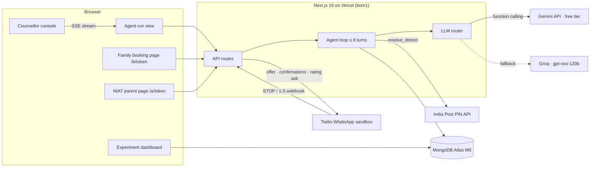

# ParentBridge

**An AI agent that turns “we’ll think about it” into a call with a parent from the family’s own district.**

Live demo: **https://parentbridge-five.vercel.app** — no login. Code: https://github.com/HarshVaibhav09/parentbridge *All families and parents are synthetic.*

NIAT families often stall after counselling. The doubt is rarely the course; it is trust: NIAT is “not a college”, fees go to two parties, and no NIAT batch has graduated yet. ParentBridge offers every family that hasn’t paid for 7+ days a free 20-minute call with the **parent of a current NIATian from their own district, in their own language**, booked on WhatsApp within 48 hours.

An AI agent:

- picks the match;
- briefs that parent on this family’s exact doubts;
- drafts the multilingual WhatsApp offer;
- summarises the call afterwards and flags overpromising.

A randomised 200 / 200 experiment decides whether to scale it. NIAT parents earn a ₹1,500 fee credit per **completed call**, never per sale.

## Try it (3 minutes)

1. **Landing → “Run the agent on a stalled family”.** This opens the Guntur showcase family. Press *Run again* to watch the live tool-call trace, including the live India Post PIN-code lookup.
2. Read the Telugu brief (toggle the English translation). Switch the WhatsApp offer to Hindi, Tamil, Kannada or Malayalam.
3. **Send WhatsApp.** The message goes live to the demo phone, or falls back to a preview with the reason shown.
4. Open **Family’s booking page**. Pick a slot, give consent and confirm. WhatsApp confirmations go to both sides.
5. **Demo shortcut → NIAT parent’s page.** Paste sample notes, or the “overpromise” sample, then **Mark call done**. You get the AI summary, red flags in red, and a ₹1,500 credit.
6. **Dashboard.** Shows the funnel per arm, lift, the win/kill verdict, breakdowns, the ambassador table and cost per extra seat. Use *Simulate 21 days* or toggle real vs simulated data.

You can also **Add a lead** with your own counselling notes and PIN code.

## Architecture



## The six connected tools

| Tool | Role | Why |
|---|---|---|
| **Next.js 16 + Vercel** | UI, API routes, streaming, public link | One deployable app; Server-Sent Events stream the agent’s steps live; Mumbai region (`bom1`) sits close to Atlas and India Post |
| **MongoDB Atlas (M0)** | leads, ambassadors, doubts, matches, agent runs, messages, bookings, calls, credit ledger, events, PIN cache, rate limits | Free; flexible documents for agent traces; aggregation pipeline powers the ambassador search; TTL index expires rate-limit counters |
| **Gemini API (free tier)** | The agent’s brain: function calling, multilingual writing, call summaries | Free, strong at Indic languages and tool use |
| **Groq (free tier)** | Fallback provider behind the same `runWithTools()` interface | Keeps the demo alive when Gemini is rate-limited or overloaded |
| **Twilio WhatsApp sandbox** | Offer, booking confirmations (both sides), reminder, trust-rating request; inbound STOP and 1–5 replies | Where Indian parents actually are |
| **India Post PIN code API** (public data) | PIN → district/state, live, with a cache fallback | Same-district matching from data families already give |

## How the agent works

The agent is a function-calling loop, implemented in [lib/agent/loop.ts](lib/agent/loop.ts) and [lib/agent/tools.ts](lib/agent/tools.ts):

- It runs at most 8 model turns.
- Independent tools run in the same turn.
- Every tool call is validated with zod, executed server-side, logged to `agent_runs.steps`, and streamed to the browser.

| # | Tool | What it does |
|---|---|---|
| 1 | `get_lead` | Reads the family and counselling notes. Phone numbers are never sent to the model. |
| 2 | `extract_doubts` | Saves structured doubts (category, quote, severity). **Each quote is verified against the notes**, and quotes not found there are flagged. |
| 3 | `resolve_district` | Calls the live **India Post API** with a 3 s timeout, then falls back to the `pincode_district` cache (`source: "cache"`). |
| 4 | `search_ambassadors` | MongoDB aggregation, ordered same district → same state + university → same language. Only active, consented parents under their weekly cap are returned, least-loaded first, up to 8. |
| 5 | `score_candidates` | The agent scores every candidate. The server attaches verified facts (same district, language, university, child’s year). |
| 6 | `create_match` | Saves the best match with reasons. |
| 7 | `write_ambassador_brief` | Writes the brief in the NIAT parent’s language and in English. Rejected if the wrong script is used. Mandatory do-not-say rules are enforced. |
| 8 | `draft_family_message` | Writes the WhatsApp offer in the family’s language. It is **rejected and retried** if it is over 60 words, in the wrong script, missing `{{BOOKING_LINK}}`, or contains job or fee promises. The opt-out line is guaranteed. |

**Final output.** The final `{ match, brief, family_message, doubts }` is assembled from the tool results and validated with zod. Typical runs take 4–5 model calls and 10–20 s.

**Second agent: `summarise_call`.** It takes the NIAT parent’s notes or voice-note transcript in any language. It returns `{doubts_resolved, doubts_remaining, family_sentiment, next_best_action, red_flags}` in English. A deterministic overpromise scanner (English, romanised and Indic patterns) backs up the model’s red flags.

**Router** ([lib/llm/index.ts](lib/llm/index.ts)). One interface, `runWithTools(messages, tools)`, with Gemini and Groq implementations:

- The chain is `LLM_MODEL` → `GEMINI_FALLBACK_MODEL` → Groq `GROQ_MODEL`.
- Each call gets a 45 s timeout.
- A 429 or 5xx is retried once, then the next link is tried.
- The SDK’s own silent retries are disabled, so fallback decisions stay visible.
- The provider and model that answered each turn are shown in the trace.
- If every provider fails, the user sees a clear error and a Retry button. The app never fakes an AI response.

## Screens

| Route | What |
|---|---|
| `/` | Problem, flow diagram, three entry points, DPDP note |
| `/console` | Treatment-arm leads with district, language and status filters, ★ saved runs, “Add a lead” |
| `/console/lead/[id]` | Live agent trace, doubts, match and other candidates, brief with English toggle, phone mock, regenerate in 6 languages, Send WhatsApp, activity and outcomes |
| `/b/[token]` | Public family booking page in 6 languages: 6 slots in 48 h, consent, and a 1–5 trust rating after the call. The NIAT parent’s phone number is never shown. |
| `/a/[token]` | NIAT parent’s page: brief, booking, notes → AI summary, ₹1,500 credit |
| `/dashboard` | Experiment dashboard with simulation and a real/simulated toggle |

## Experiment design

- 400 stalled leads (AP and Telangana, mostly Telugu-speaking), randomly assigned at insert: exactly 200 treatment / 200 control.
- **Treatment** families get the ParentBridge offer. **Control** families get business-as-usual follow-up only; the console hides them and the API refuses to contact them.
- **Primary metric**: seat reserved within 14 days.
- **Win**: treatment ≥ 15% **and** ≥ 1.5× control, ≥ 30% of offered families take the call, and no rise in 30-day withdrawals. The withdrawal guardrail fails only on a statistically detectable rise (one-sided p < 0.05) because counts are small.
- **Kill**: lift < 1.2×.
- The dashboard also reports the difference with a 95% CI and a two-proportion z-test. With 200 per arm the test is noisy, and the dashboard says so.
- **Cost per extra seat** = ambassador credits on treatment families ÷ (treatment seats − control rate × treatment n).
- **Simulate 21 days** writes events flagged `simulated: true`, using the visible assumptions in [lib/simulate.ts](lib/simulate.ts). Families with real demo activity keep their real data. Leads added through “Add a lead” are not randomised, so they are excluded from experiment numbers.

## Guardrails & DPDP

- **Consent first.** No WhatsApp is sent without `consent_whatsapp`. Every message ends with “Reply STOP to opt out”, and an inbound STOP sets consent to false (START re-subscribes). The webhook validates the Twilio signature.
- **WhatsApp sandbox limits.**
  - Live sends go **only** to `DEMO_WHATSAPP_TO`, which stands in for the synthetic families.
  - Sends are spaced at least 3 s apart, with a daily cap.
  - Async failures (63015/63016) are checked, and any error falls back to a phone-style preview plus a `wa.me` link.
- **Public demo limits.** Agent runs are limited to 15 per IP per day plus a global daily cap, counted in MongoDB with a TTL index. IPs are stored only as salted hashes. Saved runs open instantly without spending quota.
- **Token caps.** Each run has a token cap. Tokens, model calls and duration are logged per run and shown on the run view.
- **No overpromising.** The agent never promises jobs or placements. The brief carries a do-not-say list, and call summaries flag overpromising in red.

## Run locally

```bash
cd parentbridge
npm install
cp .env.example .env.local      # fill MONGODB_URI, GEMINI_API_KEY (+ GROQ_API_KEY, Twilio optional)
npm run seed                    # 25 NIAT parents, 400 leads, PIN cache (synthetic)
npm run agent:test              # run the agent on 3 showcase families from the CLI
npm run dev                     # http://localhost:3000
```

Other scripts:

- `npm test`: India Post tool tests (522002 → Guntur, timeout fallback).
- `npm run demo:prerun`: saves agent runs for showcase and per-district families.
- `npm run demo:reset`: clean state before a recording.
- `npm run seed -- --reset`: wipe and reseed.

Environment variables: see [.env.example](.env.example).

For WhatsApp, join the Twilio sandbox from your phone, then send any message to it to open the 24-hour window. Set the inbound webhook to `https://<your-domain>/api/webhooks/twilio`.

## Known limitations

- **Synthetic data.** Names, notes, phone numbers and outcomes are fictional. Simulated outcomes are assumptions, not evidence.
- **Twilio sandbox.**
  - It can only message numbers that joined. The join expires after 3 days, and free-form text only works within 24 h of your last message.
  - Without that, sends fall back to previews.
  - The demo phone maps inbound replies to the most recently messaged family.
- **India Post data is pre-2022.** It reports districts such as Krishna or Chittoor. ParentBridge maps them to canonical keys so Vijayawada families still match NTR-district parents.
- **Free-tier AI.** The Gemini Flash models sometimes return “high demand” (503) or hang. The router times out and falls back, which can add up to 45 s to one turn.
- **No authentication.** Console and dashboard are public by design for reviewers. The booking page shows a labelled *demo shortcut* to the NIAT parent’s page.
- **Simplified scheduling.** Slots aren’t synced with NIAT parents’ calendars, and call links are public Jitsi rooms.
- **No semantic translation check.** UI strings in 6 languages are hand-written. AI messages are validated for script, length and promises, not for meaning.

---

Built with Claude Code.
